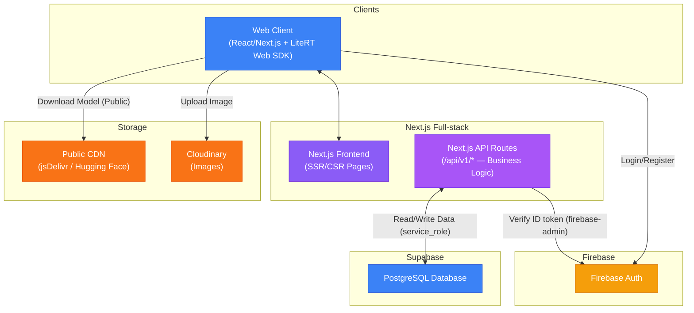
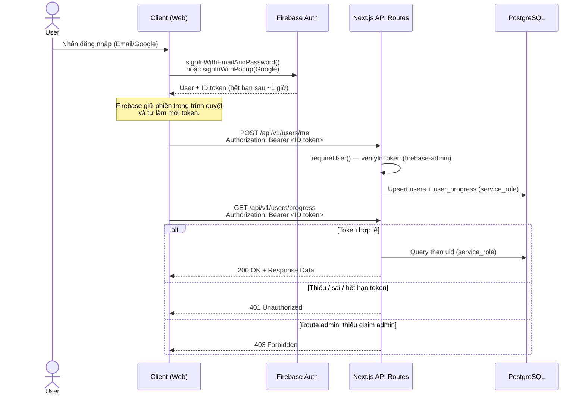
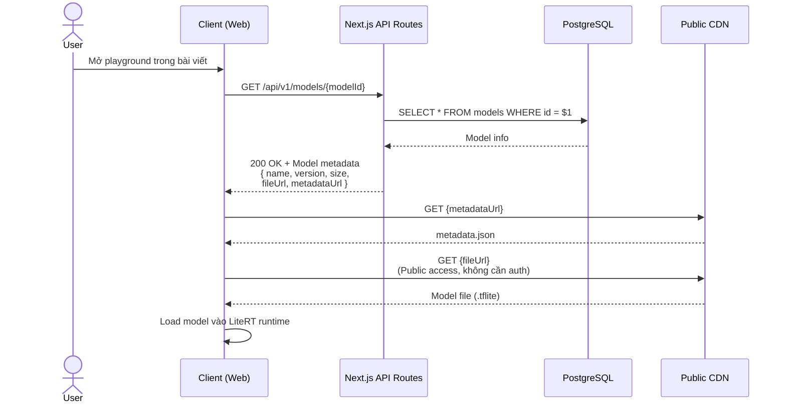
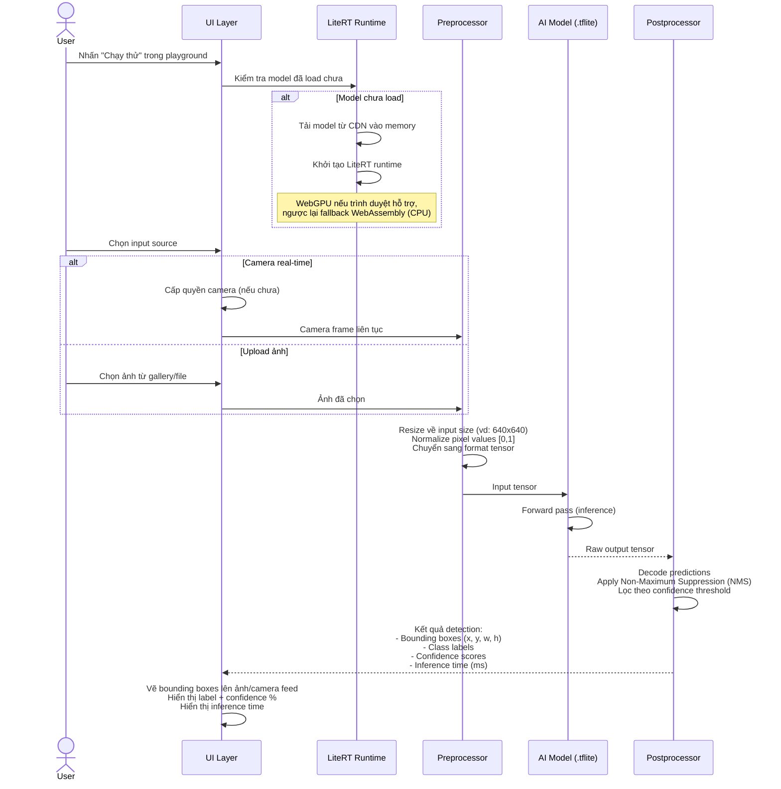
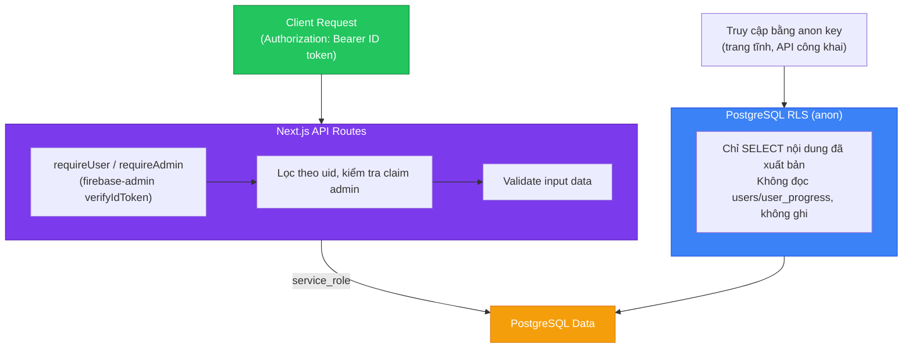

# Kiến trúc hệ thống — Sequoia

> Tài liệu mô tả kiến trúc tổng thể, tech stack, các luồng dữ liệu chính và chiến lược bảo mật của nền tảng Sequoia.
> Cập nhật lần cuối: 2026-08-19

---

## 1. Sơ đồ kiến trúc tổng thể



**Nguyên tắc thiết kế chính:**

- **Next.js là trung tâm điều phối** — Web Frontend và API Routes cùng deploy trong một ứng dụng, giảm overhead vận hành.
- **AI inference chạy hoàn toàn on-device** — API không xử lý inference, chỉ cung cấp metadata và URL tải model.
- **Client tải model trực tiếp từ CDN** — API không proxy dữ liệu lớn qua server để giảm tải bandwidth và latency.
- **Firebase Auth là nguồn xác thực duy nhất** — client đăng nhập bằng Firebase, API kiểm tra Firebase ID token. Supabase chỉ làm database.

---

## 2. Tech stack chi tiết

### 2.1. Tổng quan theo component

| Component | Technology | Vai trò |
| ----------- | ----------- | --------- |
| **Web Frontend** | React / Next.js (App Router) | SSR/CSR cho giao diện web, render bài viết, nhúng playground |
| **Web AI Runtime** | LiteRT Web SDK (WebGPU, fallback WebAssembly) | Chạy model AI trực tiếp trên trình duyệt |
| **Web API** | Next.js API Routes | RESTful API, business logic, xác thực |
| **Database** | PostgreSQL (Supabase) | Relational database với RLS, triggers, JSONB |
| **Authentication** | Firebase Auth | Quản lý user, hỗ trợ email/password và Google Sign-In |
| **Model Storage** | Public CDN (jsDelivr / Hugging Face) | Host model files, miễn phí, globally distributed |
| **Image Storage** | Cloudinary | Upload và serve hình ảnh bài viết |

### 2.2. Chi tiết từng lớp

#### Web Client (Next.js)

| Thư viện / Công cụ | Mục đích |
| --------------------- | ---------- |
| React / Next.js (App Router) | Framework UI chính, SSR + API Routes |
| firebase / firebase-admin | Đăng nhập trên client, kiểm tra ID token trên server |
| KaTeX | Render công thức toán LaTeX trong bài viết |
| react-markdown + remark-gfm | Render Markdown content |
| LiteRT Web SDK | Load và chạy `.tflite` model qua WebGPU (fallback WebAssembly) |
| Tailwind CSS | Styling framework |

---

## 3. Luồng xác thực (Authentication Flow)



**Ghi chú quan trọng:**

- Firebase ID token có **thời hạn 1 giờ**. `apiFetch` gọi `getIdToken()` trước mỗi request, hàm này tự làm mới token khi sắp hết hạn.
- API Routes **không lưu session** — mỗi request đều verify token độc lập (stateless).
- Một số endpoint public (đọc bài viết, xem danh sách) **không yêu cầu auth**.

---

## 4. Luồng download model



**Caching:** Ứng dụng không tự cache model (không dùng Cache API / IndexedDB, Service Worker bỏ qua request cross-origin). Việc tải lại hay không phụ thuộc hoàn toàn vào HTTP cache của trình duyệt theo header của CDN.

**Tại sao dùng Public CDN?**

- Model files là tài nguyên giáo dục, không chứa dữ liệu nhạy cảm.
- Public CDN (jsDelivr, Hugging Face) giúp client tải trực tiếp mà không cần proxy qua API, giảm latency.
- CDN miễn phí và globally distributed → tối ưu chi phí và tốc độ.

---

## 5. Luồng inference on-device



**Accelerator của LiteRT Web SDK:**

Code hiện tại ([useModelLoader.ts](../../src/hooks/playground/useModelLoader.ts)) gọi `loadAndCompile(url)` không truyền `accelerator`, nên LiteRT.js tự chọn theo trình duyệt:

| Accelerator | Điều kiện | Ghi chú |
| ----------- | --------- | ------- |
| **WebGPU** | Trình duyệt có `navigator.gpu` và tạo được GPU device (`powerPreference: high-performance`) | Được chọn mặc định nếu khả dụng |
| **WASM (CPU)** | Không có WebGPU hoặc tạo GPU device thất bại | Fallback |

> [!NOTE]
> Phần lõi của LiteRT.js luôn là WebAssembly (`loadLiteRt()` tải file `.wasm` từ CDN), kể cả khi inference chạy trên WebGPU. LiteRT.js không có backend WebGL.
> Latency thực tế cần đo qua Telemetry Panel trên từng thiết bị.

---

## 6. Bảo mật defense-in-depth

### 6.1. Mô hình bảo vệ



### 6.2. Ai bảo vệ cái gì?

| Kịch bản | Bảo vệ bởi |
| --- | --- |
| Request tới API không có token / token giả | `requireUser` trả `401` |
| User thường gọi route admin | `requireAdmin` trả `403` |
| Đọc hoặc ghi tiến độ của người khác | API luôn lọc theo `uid` lấy từ token, không lấy từ request |
| Bỏ qua API, dùng anon key gọi thẳng Supabase | RLS: chỉ đọc được nội dung đã xuất bản, không ghi được gì |

Vì API dùng `service_role` (bỏ qua RLS), mọi route chạm dữ liệu người dùng hoặc ghi dữ liệu **bắt buộc** gọi `requireUser` / `requireAdmin` trước.

### 6.3. Nguyên tắc bảo mật bổ sung

- **HTTPS everywhere** — Vercel tự cung cấp SSL.
- **`SUPABASE_SERVICE_ROLE_KEY` và `FIREBASE_SERVICE_ACCOUNT` chỉ dùng phía server** — không bao giờ import trong Client Components.
- **Input validation** — API validate mọi input trước khi xử lý.
- **CORS** — Chỉ cho phép origin của web client.
- **Model files là public** — Không chứa dữ liệu nhạy cảm.

---

## 7. Cấu trúc thư mục dự án

```text
Sequoia/
├── web/                        # Web client + API (Next.js Full-stack)
│   ├── src/
│   │   ├── app/               # Next.js App Router
│   │   │   ├── api/v1/        # API Routes (REST endpoints)
│   │   │   │   ├── admin/     # Admin CRUD (articles, topics, models, textbooks)
│   │   │   │   ├── users/     # User profile & progress
│   │   │   │   └── cosmos/    # Cosmos maps
│   │   │   ├── auth/          # Auth page
│   │   │   ├── dashboard/     # User dashboard
│   │   │   ├── genesis/       # Admin CMS (Genesis Core)
│   │   │   ├── articles/      # Article pages
│   │   │   └── playground/    # Model playground
│   │   ├── components/        # Reusable UI components
│   │   │   ├── admin/         # Admin components (GenesisClient, Forges)
│   │   │   ├── cosmos/        # Galaxy map, nodes
│   │   │   └── ui/            # Common UI elements
│   │   ├── hooks/             # Custom React hooks
│   │   ├── services/          # Service layer (AdminService, UploadService)
│   │   ├── utils/             # Utilities
│   │   │   └── supabase/      # Supabase clients (client.ts, server.ts, admin.ts)
│   │   └── contexts/          # React contexts (Auth, Theme)
│   ├── scripts/               # Seed scripts
│   ├── supabase/migrations/   # SQL migration files
│   ├── package.json
│   └── next.config.ts
│
├── docs/                       # Tài liệu dự án
│   ├── design/                # Thiết kế kỹ thuật
│   ├── analysis/              # Phân tích luồng người dùng
│   ├── requirements/          # PRD
│   ├── management/            # Quy ước, master plan
│   ├── operations/            # Hướng dẫn triển khai
│   └── guides/                # Hướng dẫn sử dụng
│
├── .github/                    # CI/CD workflows
├── .gitignore
└── README.md
```

**Quy ước đặt tên:**

| Quy ước | Ví dụ | Áp dụng cho |
| --------- | ------- | ------------- |
| camelCase | `useAuth.ts`, `adminService.ts` | TypeScript files, hooks |
| PascalCase | `GenesisClient.tsx`, `PlaygroundCard.tsx` | React components |
| kebab-case | `user-flows.md`, `api-contract.md` | Documentation files |
| snake_case | `seed_models.ts`, `00_init.sql` | Seed scripts, SQL migrations |
