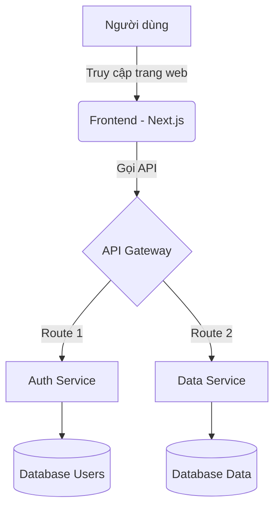
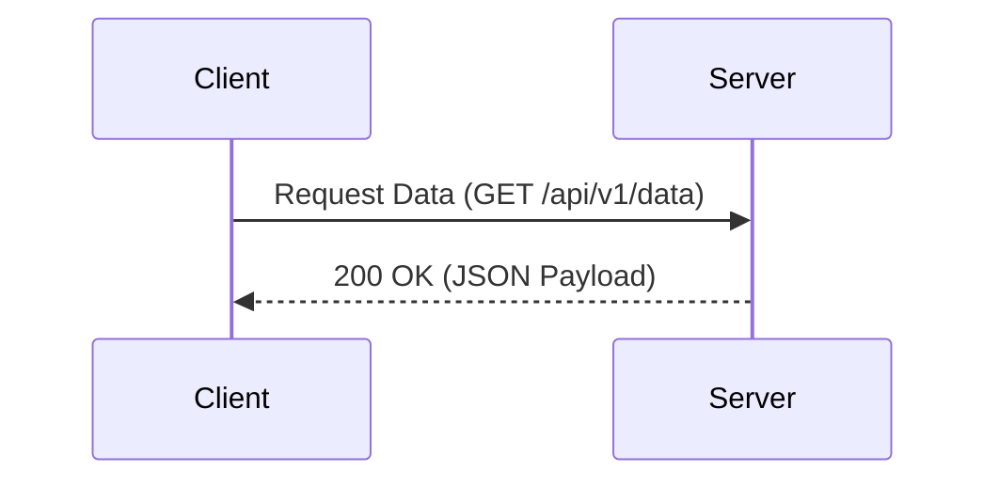

# Hệ thống Tài liệu Antigravity

## Giới thiệu chung

Đây là file markdown mẫu được tạo ra để demo tất cả các tính năng mà `MarkdownRenderer` của dự án đang hỗ trợ. Nó bao gồm từ các định dạng cơ bản đến các thành phần nâng cao như Toán học, Biểu đồ và Callouts.

### Định dạng Văn bản (Typography)

Bạn có thể sử dụng các định dạng chữ như: **chữ in đậm**, *chữ in nghiêng*, và ~~chữ gạch ngang~~.
Đối với code nội tuyến (inline code), nó sẽ trông như thế này: `const a = 1;`.

Các liên kết (links) cũng được tuỳ biến giao diện khi hover, ví dụ: [Trang chủ Next.js](https://nextjs.org).

### Danh sách (Lists)

Danh sách không thứ tự (Unordered List):

* Mục thứ nhất
* Mục thứ hai
  * Mục con A
  * Mục con B
* Mục thứ ba

Danh sách có thứ tự (Ordered List):

1. Bước đầu tiên: Chuẩn bị môi trường
2. Bước thứ hai: Cài đặt thư viện
3. Bước thứ ba: Khởi chạy dự án

Danh sách công việc (Task lists):

* [x] Đã hoàn thành code UI
* [x] Tích hợp MarkdownRenderer
* [ ] Viết Unit Test cho các components
* [ ] Deploy lên production

## Các Thành phần Nâng cao

### Hộp thoại (Callouts)

Hệ thống hỗ trợ các hộp thoại (Callout) giống GitHub với nhiều loại khác nhau:

> [!NOTE] Ghi chú
> Đây là một callout loại NOTE. Thường dùng để bổ sung thông tin chi tiết hoặc ngữ cảnh cho người đọc.

### Công thức Toán học (KaTeX)

Hệ thống hỗ trợ viết công thức toán học nội tuyến như $E = mc^2$ hoặc khối công thức (block math) riêng biệt:

$$
f(x) = \int_{-\infty}^\infty \hat f(\xi)\,e^{2 \pi i \xi x} \,d\xi
$$

$$
A = \begin{pmatrix}
a_{11} & a_{12} \\
a_{21} & a_{22}
\end{pmatrix}
$$

### Khối Mã nguồn (Code Blocks)

Các khối code được highlight cú pháp bằng `react-syntax-highlighter` (theme vscDarkPlus) và có nút Copy tiện lợi:

```tsx
import React from 'react';

// Ví dụ một Component React đơn giản
interface Props {
  name: string;
}

export const Greeting: React.FC<Props> = ({ name }) => {
  return (
    <div className="p-4 text-white">
      <h1>Xin chào, {name}!</h1>
    </div>
  );
};
```

### Bảng (Tables)

Bảng GFM được render với đường viền và hiệu ứng hover:

| Tính năng | Tình trạng | Ghi chú |
| :--- | :---: | :--- |
| **Markdown Cơ bản** | Hoàn thành | Đã test OK |
| **Biểu đồ Mermaid** | Hoàn thành | Render SVG trực tiếp |
| **Toán học KaTeX** | Hoàn thành | Hỗ trợ inline và block |
| **Dark Mode** | Đang làm | Cần tinh chỉnh màu sắc |

### Hình ảnh (Images)

Hình ảnh sẽ được bọc trong thẻ `<figure>`, có hiệu ứng phát sáng mờ phía sau. Thuộc tính `alt` sẽ tự động trở thành một caption mang phong cách Terminal (IMG_CAPTION).


### Biểu đồ Mermaid

Bạn có thể vẽ các biểu đồ luồng, sơ đồ tuần tự... trực tiếp bằng code text (chỉ định language là `mermaid`):





## Tổng kết

Đây là phần kết luận của file demo. Lưu ý rằng các tiêu đề H2 (`##`) và H3 (`###`) ở trên đã tự động được trích xuất để tạo thành bảng mục lục (TOC) nằm ở góc phải (hoặc full width) trên cùng của trang web!
